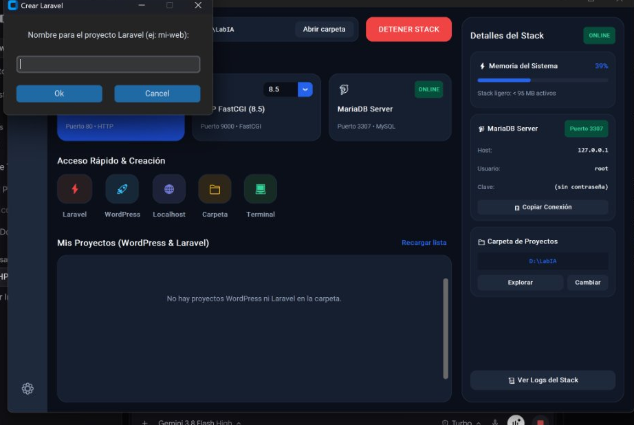

<div align="center">

# ⚡ AetherStack

**High-Performance, Weightless Local Development Suite for Windows**  
*Modern, ultra-lightweight and portable local dev environment for PHP, Laravel and WordPress.*

[](https://www.php.net/)
[](https://nginx.org/)
[-C0765A?style=for-the-badge&logo=mariadb&logoColor=white)](https://mariadb.org/)
[](https://www.heidisql.com/)
[](LICENSE)
[](https://microsoft.com)

<br/>

**Choose Language / Elige Idioma:**  
[ 🇺🇸 **English** ](#-english) &nbsp;&bull;&nbsp; [ 🇪🇸 **Español** ](#-español)

<br/>



</div>

---

# 🇺🇸 English

## 📋 Table of Contents

1. [Overview](#1-overview)
2. [Why AetherStack?](#2-why-aetherstack)
3. [Stack Components](#3-stack-components)
4. [Key Features](#4-key-features)
5. [Project Structure](#5-project-structure)
6. [Quick Start Guide](#6-quick-start-guide)
7. [Project Management](#7-project-management)
8. [Database & HeidiSQL](#8-database--heidisql)
9. [Development Terminal](#9-development-terminal)
10. [Official Technical Documentation](#10-official-technical-documentation)
11. [License](#11-license)

---

### 1. Overview

**AetherStack** is a modern, minimalist, high-performance alternative to traditional local development tools such as Laragon, XAMPP, and Docker Desktop. Specifically built for developers creating **Laravel**, **WordPress**, and modern PHP applications on Windows, it provides an ad-free experience without intrusive donation popups, heavy installers, or external system dependencies.

The entire stack is **100% portable and self-contained**: it does not touch the Windows Registry, resolves all paths dynamically with relative resolution, and allows copying the full folder to another PC or external USB drive while preserving all databases, settings, and virtual hosts intact.

---

### 2. Why AetherStack?

| Criteria | AetherStack ⚡ | Laragon 🐘 | Docker Desktop 🐳 | XAMPP 📦 |
| :--- | :---: | :---: | :---: | :---: |
| **Boot Time** | **< 1.0 second** | ~3-5 seconds | ~30-60 seconds | ~5-10 seconds |
| **RAM Memory Footprint** | **< 95 MB** | ~180-250 MB | ~2.5 GB - 4.5 GB | ~250-400 MB |
| **Popups / Donation Prompts** | **0 (Completely clean)** | Frequent | Notifications | None |
| **Port Conflicts (MySQL)** | **No conflict (3307)** | Uses 3306 | Uses 3306 | Uses 3306 |
| **PHP Version Switcher** | **8.1, 8.2, 8.3, 8.4, 8.5** | Manual | Via Dockerfile | Complex manual setup |
| **Database Manager** | **Integrated Portable HeidiSQL** | External HeidiSQL | Container phpMyAdmin | Web phpMyAdmin |
| **Portability** | **100% Self-contained** | Semi-portable | Not portable | Fixed installer |

---

### 3. Stack Components

| Service | Version / Detail | Port | Protocol |
| :--- | :--- | :---: | :--- |
| **Nginx** | 1.28.0 Mainline optimized for Windows | `80` | HTTP / FastCGI Proxy |
| **PHP Engine** | 8.1, 8.2, 8.3, 8.4, and 8.5 (NTS x64) | `9000` | FastCGI Daemon |
| **MariaDB** | 11.8.x LTS Portable Edition | `3307` | TCP/IP (Avoids default 3306 conflict) |
| **HeidiSQL** | 12.22 Portable Edition (dark theme) | Desktop | Native Windows GUI |
| **Composer** | 2.8.x Portable PHAR with isolated cache | CLI | CLI Package Manager |
| **Aether Console** | Native desktop client (SaaS Dark UI) | GUI | Python CustomTkinter 5.2+ |

---

### 4. Key Features

#### ⚡ On-The-Fly Multi-Version PHP Switcher
Switch between **PHP 8.1, 8.2, 8.3, 8.4, and 8.5** with a single click from the top dropdown menu. The FastCGI service switches seamlessly in the background without restarting Nginx or interrupting active work.

#### 🚀 1-Click Automated Scaffolders
- **Laravel:** Downloads the official release via Composer, provisions the MariaDB database (`<name>_db`), configures the `.env` file with port `3307`, and creates the Virtual Host pointing to `/public`.
- **WordPress:** Downloads the official core, provisions the MariaDB database, sets up `wp-config.php` with unique authentication salts, and registers the local Virtual Host.

#### 🗄️ Integrated Portable HeidiSQL
Includes Laragon's official desktop database manager preconfigured. Clicking the **"DB Manager"** button or the database icon next to any project opens HeidiSQL connected directly to MariaDB on port 3307.

#### 🌐 Native Bilingual Support (EN / ES)
Instant toggle button `🌐 EN` / `🌐 ES` in the top bar with persistent configuration. Translates the entire user interface, dialogs, warnings, and confirmations in real time.

#### 🛡️ Offline Preventive Guard
Smart safeguard in both the UI and core engine: if services are stopped, creating projects or launching the database manager is blocked to prevent orphaned files or connection errors.

#### 📦 Full Plug & Play Portability
All internal paths across MariaDB (`my.ini`), Nginx (`nginx.conf`, vhosts), PHP (`php.ini`), and batch scripts use relative paths. Copying the folder to another PC or external USB drive works out-of-the-box without manual reconfigurations.

---

### 5. Project Structure

```text
aetherstack/
├── bin/                       # Portable ecosystem binaries
│   ├── composer/              # Composer PHAR and runner script
│   ├── heidisql/              # HeidiSQL Portable v12.22
│   ├── mariadb/               # MariaDB 11.8 engine and CLI utilities
│   ├── nginx/                 # Nginx 1.28 web server
│   └── php/                   # Isolated PHP versions (8.1, 8.2, 8.3, 8.4, 8.5)
├── conf/                      # Master configuration files
│   ├── my.ini                 # MariaDB configuration (port 3307)
│   ├── nginx.conf             # Nginx master config with FastCGI upstream
│   ├── state.json             # Persistent state and directory paths
│   └── vhosts/                # Autogenerated Virtual Hosts (*.conf)
├── data/                      # MariaDB physical database files
├── docs/                      # Formal documentation suite (/docs)
├── logs/                      # Centralized log storage (Nginx, PHP, MariaDB)
├── AetherStack.bat            # Optimized GUI application launcher
├── app.py                     # Modern desktop interface (SaaS Dark Theme)
├── core.py                    # Orchestration engine, sockets and processes
├── i18n.py                    # Internationalization module (ES / EN)
├── start.bat                  # Headless console startup script
└── stop.bat                   # Clean console shutdown script
```

---

### 6. Quick Start Guide

#### Desktop Shortcut
Requires Python 3.12+ on Windows. Install the dependencies once:

```cmd
python -m pip install -r requirements.txt
```

Double-click `AetherStack.bat` to launch the GUI. To create a desktop shortcut with the custom icon (`icon.ico`), run once:
```cmd
python generate_icon.py
```
The portable ZIP does not ship a `.lnk` file because shortcuts store machine-specific paths.

#### Command-Line Operations
If you prefer running the stack headlessly without the GUI, run directly from the project directory:
```cmd
:: Start all services (Nginx, PHP FastCGI, MariaDB)
start.bat

:: Stop all processes cleanly
stop.bat
```

---

### 7. Project Management

All projects are created inside the configured root projects directory (customizable at any time via the Settings modal).

Every project is immediately accessible via two HTTP methods:
1. **Direct subdirectory URL:**
   ```text
   http://localhost/<project-name>/
   ```
2. **Local Virtual Host URL:**
   ```text
   http://<project-name>.local
   ```

*Note for Laravel:* Nginx automatically routes the root to the `/public` directory.

---

### 8. Database & HeidiSQL

MariaDB is pre-initialized and configured on dedicated port **3307** to ensure complete compatibility with Docker, WSL, or existing local MySQL services running on default port 3306:

- **Host:** `127.0.0.1` (or `localhost`)
- **Port:** `3307`
- **User:** `root`
- **Password:** *(empty / no password by default)*

> **Security note:** MariaDB, PHP-FastCGI and Nginx listen on `127.0.0.1` only, so nothing is reachable from your network. Do not change the bind address: `root` has no password. Project names accept only letters, numbers, `-` and `_`.
- **Default Character Set:** `utf8mb4`
- **Default Collation:** `utf8mb4_unicode_ci`

Connect via the **DB Manager** button (opens preconfigured HeidiSQL Portable) or from any external database GUI (DBeaver, TablePlus, VS Code, or PhpStorm) targeting port **3307**.

---

### 9. Development Terminal

Clicking the **Terminal** button in the dashboard quick actions opens a `cmd.exe` console pre-wired for your active environment:
- Working directory starts directly in your active projects folder.
- The `PATH` environment variable is loaded with the active PHP version, Composer, and the MariaDB CLI client.
- Run global commands directly:
  ```bash
  php -v
  composer create-project ...
  mariadb -u root -P 3307
  php artisan migrate
  ```

---

### 10. Official Technical Documentation

The project includes formal specifications and architecture records under [`docs/`](docs/):

| Document | Title | Description |
| :--- | :--- | :--- |
| [`01_PRD.md`](docs/01_PRD.md) | Product Requirements | Functional and non-functional requirements specification. |
| [`02_TASKS.md`](docs/02_TASKS.md) | Open Tasks | Open work and where the project was left. |
| [`03_DECISIONS.md`](docs/03_DECISIONS.md) | Architecture Records | Index and record of technical decisions and trade-offs. |
| [`04_CHANGELOG.md`](docs/04_CHANGELOG.md) | Changelog | Version history adhering to the Keep a Changelog standard. |
| [`ARCHITECTURE.md`](docs/ARCHITECTURE.md) | Architecture | Component design, port topology, runtimes, and config directives. |
| [`DATA_MODEL.md`](docs/DATA_MODEL.md) | Data Model | Internal state schema (`state.json`, vhosts, system tables). |
| [`TESTING.md`](docs/TESTING.md) | Testing Strategy | Verification suite for ports, processes, FastCGI, and scaffolders. |
| [`RUNBOOK.md`](docs/RUNBOOK.md) | Operations Runbook | Maintenance, troubleshooting, release, and backup procedures. |

---

### 11. License

This project is licensed under the **MIT License**. You are free to use, modify, and distribute it for personal or commercial projects without restrictions.

<br/>

---

# 🇪🇸 Español

## 📋 Tabla de Contenidos

1. [Visión General](#1-visión-general)
2. [¿Por qué AetherStack?](#2-por-qué-aetherstack)
3. [Componentes del Stack](#3-componentes-del-stack)
4. [Características Principales](#4-características-principales)
5. [Estructura del Proyecto](#5-estructura-del-proyecto)
6. [Guía de Inicio Rápido](#6-guía-de-inicio-rápido)
7. [Gestión de Proyectos](#7-gestión-de-proyectos)
8. [Base de Datos & HeidiSQL](#8-base-de-datos--heidisql)
9. [Terminal de Desarrollo](#9-terminal-de-desarrollo)
10. [Documentación Técnica Oficial](#10-documentación-técnica-oficial)
11. [Licencia](#11-licencia)

---

### 1. Visión General

**AetherStack** nace como una alternativa moderna, minimalista y de alto rendimiento a herramientas tradicionales como Laragon, XAMPP y Docker Desktop. Diseñado específicamente para desarrolladores que trabajan con **Laravel**, **WordPress** y aplicaciones PHP contemporáneas sobre Windows, ofrece una experiencia libre de anuncios, donaciones intrusivas, instaladores pesados y dependencias externas.

Todo el stack es **100% portable y autocontenido**: no escribe en el Registro de Windows, resuelve todas sus rutas de forma relativa y permite trasladar la suite completa a otra PC o unidad USB manteniendo todas las bases de datos y configuraciones intactas.

---

### 2. ¿Por qué AetherStack?

| Criterio | AetherStack ⚡ | Laragon 🐘 | Docker Desktop 🐳 | XAMPP 📦 |
| :--- | :---: | :---: | :---: | :---: |
| **Tiempo de Arranque** | **< 1.0 segundo** | ~3-5 segundos | ~30-60 segundos | ~5-10 segundos |
| **Consumo de Memoria (RAM)** | **< 95 MB** | ~180-250 MB | ~2.5 GB - 4.5 GB | ~250-400 MB |
| **Ventanas emergentes / Donaciones** | **0 (Totalmente limpio)** | Frecuentes | Notificaciones | Ninguno |
| **Conflictos de Puerto (MySQL)** | **Sin conflicto (3307)** | Ocupa 3306 | Ocupa 3306 | Ocupa 3306 |
| **Conmutador de PHP** | **8.1, 8.2, 8.3, 8.4, 8.5** | Manual | Vía Dockerfile | Manual complejo |
| **Gestor de Base de Datos** | **HeidiSQL Portable integrado** | HeidiSQL externo | phpMyAdmin contenedor | phpMyAdmin web |
| **Portabilidad** | **100% Autocontenido** | Semi-portable | No portable | Instalador fijo |

---

### 3. Componentes del Stack

| Servicio | Versión / Detalle | Puerto | Protocolo |
| :--- | :--- | :---: | :--- |
| **Nginx** | 1.28.0 Mainline optimizado para Windows | `80` | HTTP / FastCGI Proxy |
| **PHP Engine** | 8.1, 8.2, 8.3, 8.4 y 8.5 (NTS x64) | `9000` | FastCGI Daemon |
| **MariaDB** | 11.8.x LTS Portable Edition | `3307` | TCP/IP (Evita colisión con 3306) |
| **HeidiSQL** | 12.22 Portable Edition (modo oscuro) | Desktop | GUI nativa de Windows |
| **Composer** | 2.8.x Portable PHAR con cache aislada | CLI | CLI Package Manager |
| **Aether Console** | Cliente de escritorio nativo (SaaS Dark UI) | GUI | Python CustomTkinter 5.2+ |

---

### 4. Características Principales

#### ⚡ Conmutador Multi-Versión de PHP en Caliente
Alterna entre **PHP 8.1, 8.2, 8.3, 8.4 y 8.5** con un solo clic desde el menú desplegable en la barra superior. El servicio FastCGI se conmuta en segundo plano sin reiniciar Nginx ni perder la sesión de trabajo.

#### 🚀 Scaffolders Automatizados en 1 Clic
- **Laravel:** Descarga la versión oficial vía Composer, crea la base de datos asociada (`<nombre>_db`), configura el archivo `.env` con el puerto `3307` y genera el Virtual Host con DocumentRoot en `/public`.
- **WordPress:** Descarga el núcleo oficial, crea la base de datos en MariaDB, preconfigura `wp-config.php` y emite el Virtual Host correspondiente.

#### 🗄️ HeidiSQL Portable Integrado
Incluye el gestor oficial de bases de datos de escritorio de Laragon preconfigurado. Un clic en el botón **"Gestor DB"** o en el icono de base de datos de cualquier proyecto abre HeidiSQL conectado automáticamente a MariaDB en el puerto 3307.

#### 🌐 Soporte Bilingüe Nativo (EN / ES)
Botón de alternancia instantánea `🌐 EN` / `🌐 ES` en la barra superior con persistencia de configuración. Traduce toda la interfaz, modales, alertas y confirmaciones en tiempo real.

#### 🛡️ Condición Preventiva Offline
Bloqueo inteligente en la interfaz y en el motor central: si los servicios están apagados, el sistema impide crear proyectos o abrir el gestor de base de datos para evitar archivos huérfanos o fallos de conexión.

#### 📦 Portabilidad Total Plug & Play
Todas las rutas internas de MariaDB (`my.ini`), Nginx (`nginx.conf`, vhosts), PHP (`php.ini`) y scripts batch se resuelven dinámicamente con rutas relativas. Copiar la carpeta a otra PC o unidad USB funciona de inmediato sin alterar datos.

---

### 5. Estructura del Proyecto

```text
aetherstack/
├── bin/                       # Binarios portables del ecosistema
│   ├── composer/              # Composer PHAR y script de ejecución
│   ├── heidisql/              # HeidiSQL Portable v12.22
│   ├── mariadb/               # Motor y herramientas CLI de MariaDB 11.8
│   ├── nginx/                 # Servidor web Nginx 1.28
│   └── php/                   # Versiones de PHP aisladas (8.1, 8.2, 8.3, 8.4, 8.5)
├── conf/                      # Archivos de configuración maestros
│   ├── my.ini                 # Configuración de MariaDB (puerto 3307)
│   ├── nginx.conf             # Servidor maestro Nginx con upstream FastCGI
│   ├── state.json             # Estado persistente del stack y rutas
│   └── vhosts/                # Virtual Hosts autogenerados (*.conf)
├── data/                      # Almacenamiento físico de bases de datos MariaDB
├── docs/                      # Suite de documentación formal (/docs)
├── logs/                      # Registro centralizado de logs (Nginx, PHP, MariaDB)
├── AetherStack.bat            # Lanzador optimizado para la aplicación gráfica
├── app.py                     # Interfaz de escritorio moderna (SaaS Dark Theme)
├── core.py                    # Motor de orquestación, sockets y procesos
├── i18n.py                    # Módulo de internacionalización (ES / EN)
├── start.bat                  # Script de arranque headless por consola
└── stop.bat                   # Script de apagado limpio por consola
```

---

### 6. Guía de Inicio Rápido

#### Acceso Directo de Escritorio
Requiere Python 3.12+ en Windows. Instala las dependencias una sola vez:

```cmd
python -m pip install -r requirements.txt
```

Haz doble clic en `AetherStack.bat` para abrir la interfaz. Para crear un acceso directo en el Escritorio con el icono propio (`icon.ico`), ejecuta una vez:
```cmd
python generate_icon.py
```
El ZIP portable no incluye ningún `.lnk` porque los accesos directos guardan rutas propias de cada equipo.

#### Control por Línea de Comandos
Si prefieres operar el stack sin interfaz gráfica, ejecuta directamente desde la carpeta del proyecto:
```cmd
:: Iniciar todos los servicios (Nginx, PHP FastCGI, MariaDB)
start.bat

:: Detener todos los procesos de forma limpia
stop.bat
```

---

### 7. Gestión de Proyectos

Todos los proyectos se ubican en la carpeta raíz configurada (modificable desde el botón de configuración de la app).

Cada proyecto cuenta con dos métodos de acceso HTTP inmediato:
1. **Acceso directo por subdirectorio:**
   ```text
   http://localhost/<nombre-proyecto>/
   ```
2. **Acceso por Virtual Host local:**
   ```text
   http://<nombre-proyecto>.local
   ```

*Nota para Laravel:* Nginx redirige automáticamente la raíz hacia la carpeta interna `/public`.

---

### 8. Base de Datos & HeidiSQL

MariaDB se encuentra preinicializado y configurado en el puerto independiente **3307** para garantizar compatibilidad total con Docker, WSL o instalaciones locales previas de MySQL en el puerto 3306:

- **Host:** `127.0.0.1` (o `localhost`)
- **Puerto:** `3307`
- **Usuario:** `root`
- **Contraseña:** *(vacía / sin contraseña por defecto)*

> **Nota de seguridad:** MariaDB, PHP-FastCGI y Nginx escuchan solo en `127.0.0.1`, por lo que nada es accesible desde tu red. No cambies la dirección de escucha: `root` no tiene contraseña. Los nombres de proyecto aceptan solo letras, números, `-` y `_`.

> **Nota de seguridad:** MariaDB, PHP-FastCGI y Nginx escuchan solo en `127.0.0.1`, por lo que nada es accesible desde tu red. No cambies la dirección de escucha: `root` no tiene contraseña. Los nombres de proyecto aceptan solo letras, números, `-` y `_`.
- **Juego de caracteres:** `utf8mb4`
- **Cotejamiento (Collation):** `utf8mb4_unicode_ci`

Puedes conectarte desde el botón **Gestor DB** (que abre HeidiSQL Portable preconfigurado) o desde cualquier cliente externo (DBeaver, TablePlus, VS Code o PhpStorm) apuntando al puerto **3307**.

---

### 9. Terminal de Desarrollo

Al pulsar el botón **Terminal** dentro de los accesos rápidos, se despliega una consola `cmd.exe` con el entorno completamente configurado:
- El directorio de trabajo inicia directamente en tu carpeta de proyectos activa.
- La variable `PATH` se precarga con los binarios de la versión activa de PHP, Composer y el cliente CLI de MariaDB.
- Puedes ejecutar directamente comandos globales como:
  ```bash
  php -v
  composer create-project ...
  mariadb -u root -P 3307
  php artisan migrate
  ```

---

### 10. Documentación Técnica Oficial

El proyecto cuenta con especificaciones técnicas completas dentro de [`docs/`](docs/):

| Documento | Título | Descripción |
| :--- | :--- | :--- |
| [`01_PRD.md`](docs/01_PRD.md) | Requisitos del Producto | Especificación de requisitos funcionales y no funcionales. |
| [`02_TASKS.md`](docs/02_TASKS.md) | Tareas Abiertas | Trabajo abierto y dónde quedó el proyecto. |
| [`03_DECISIONS.md`](docs/03_DECISIONS.md) | ADRs (Architecture Records) | Índice y registro de decisiones técnicas y sus alternativas. |
| [`04_CHANGELOG.md`](docs/04_CHANGELOG.md) | Registro de Cambios | Historial de versiones bajo el estándar Keep a Changelog. |
| [`ARCHITECTURE.md`](docs/ARCHITECTURE.md) | Arquitectura | Diseño de componentes, topología de puertos, runtimes y configuración. |
| [`DATA_MODEL.md`](docs/DATA_MODEL.md) | Modelo de Datos | Esquema de persistencia interna (`state.json`, vhosts, tablas del sistema). |
| [`TESTING.md`](docs/TESTING.md) | Estrategia de Pruebas | Suite de verificación de puertos, procesos, FastCGI y generadores. |
| [`RUNBOOK.md`](docs/RUNBOOK.md) | Manual de Operaciones | Procedimientos de mantenimiento, release, solución de problemas y respaldo. |

---

### 11. Licencia

Este proyecto está liberado bajo la licencia **MIT**. Eres libre de usarlo, modificarlo y distribuirlo para proyectos personales o comerciales sin restricciones.
